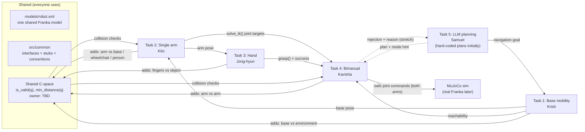
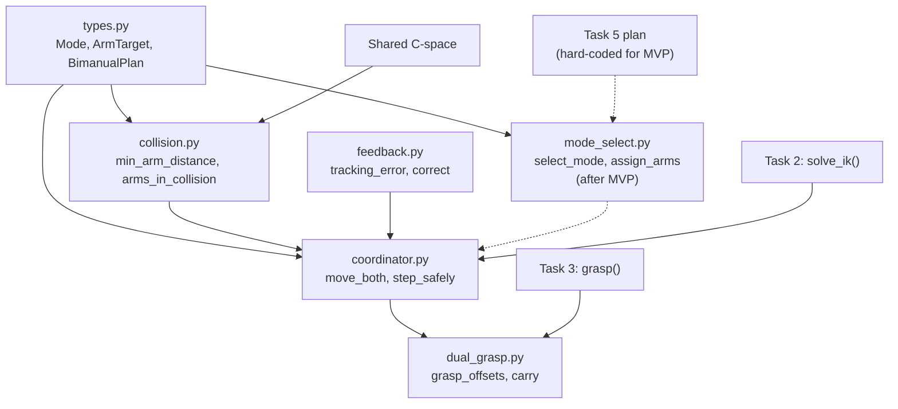

# Architecture & Dependencies
This file shows how all the parts of the project depend on each other. The first diagram covers the whole system. The LLM (task 5) makes a plan. The base (task 1) drives to the right spot. The single-arm code (task 2) works out how to reach, the hand (task 3) grasps, and your bimanual task (task 4) combines all of these into safe two-arm motion that runs in MuJoCo. Everyone shares one robot model, one set of interfaces, and one collision checker that each task adds its own checks to. Solid arrows are needed for the MVP and dotted arrows come later. The interfaces table then lists, in plain terms, what each task hands to the others and what fake placeholder to use until the real thing exists. The second diagram zooms into how your own task’s code is split into modules. The last section lists the dependency questions that are still open.

Last updated: 20 Nov 2026. Solid arrows = needed for the MVP. Dotted arrows = after MVP / stretch.

## 1. Project-level dependencies

All tasks load the robot from `models/robot.xml` and code against the interfaces in `src/common` (arrows left out to keep the diagram readable).

## 2. Interfaces

| Interface | Provided by | Used by | MVP placeholder |
|---|---|---|---|
| Plan `{mode, roles, objects, target}` | Task 5 | Task 1, Task 4 | Hard-coded plan; mode passed in as input |
| Navigation goal → base pose | Task 1 | Task 2, Task 4 | Fixed base position |
| Reachability check | Task 1 | Task 4 | Assume reachable |
| `solve_ik(arm, target_pose) -> joint_angles` | Task 2 | Task 3, Task 4 | Stub / MuJoCo IK (e.g. mink) |
| `grasp(hand, object) -> success` | Task 3 | Task 4 | Simple gripper close |
| `is_valid(q)`, `min_distance(q)` | Shared C-space | Task 2, Task 4 | Task 4's own arm-to-arm check |
| Rejection + reason | Task 4 | Task 5 | Not in MVP (stretch) |

## 3. Task 4 internal modules (`src/bimanual/`)

## 4. Open dependency questions

- Who owns the shared C-space?
- Final plan format with task 5.
- Does task 3 depend on task 1 directly, or only through task 2?